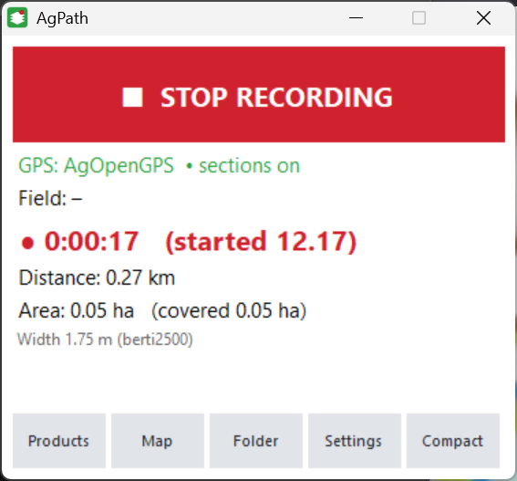
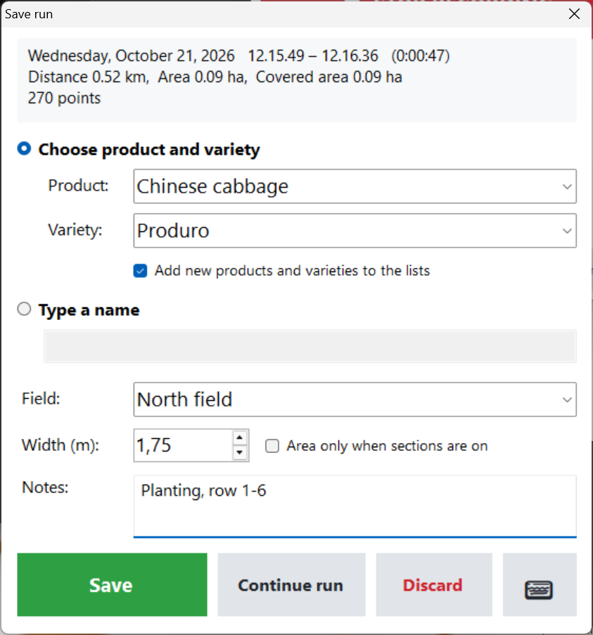
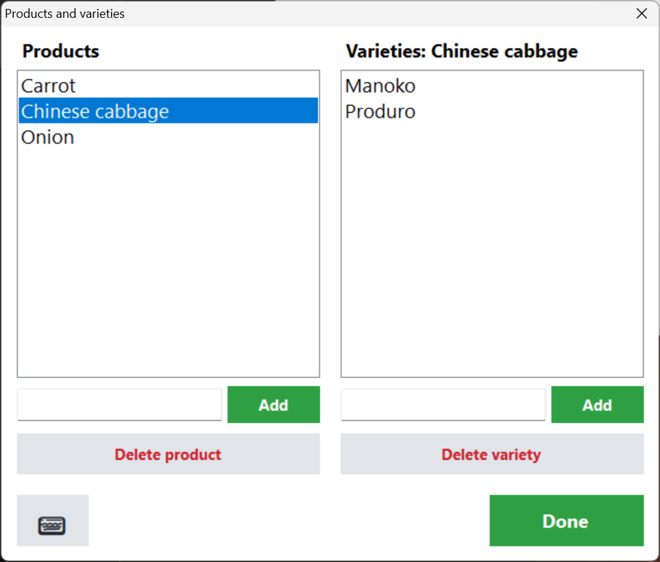
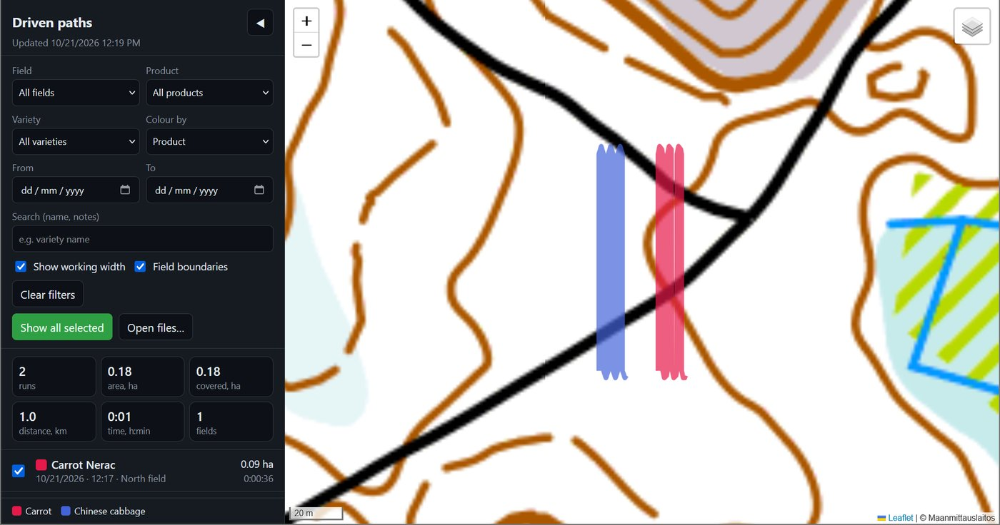
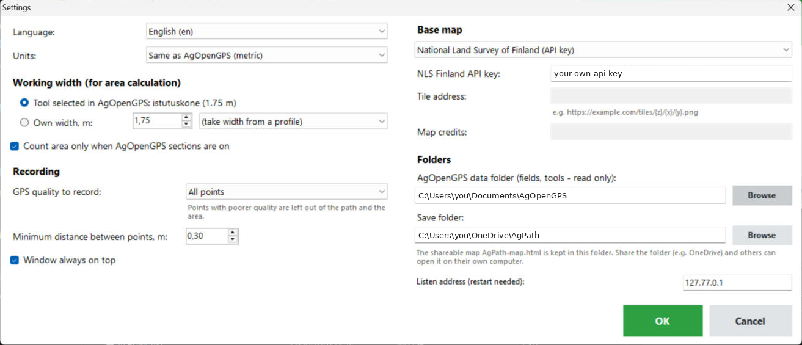

# AgPath user guide

*[Suomeksi: OHJE.md](OHJE.md)*

AgPath runs next to AgOpenGPS and records the paths you drive. You can record as many runs per field as
you like. Each run is saved with its crop (product) and variety, the times and the area. AgOpenGPS itself
is not changed in any way.

- [1. Install](#1-install)
- [2. Recording a run](#2-recording-a-run)
- [3. Saving a run](#3-saving-a-run)
- [4. Products and varieties](#4-products-and-varieties)
- [5. The map](#5-the-map)
- [5b. Sharing the map](#5b-sharing-the-map)
- [6. Settings](#6-settings)
- [7. Where the data is](#7-where-the-data-is)
- [8. Troubleshooting](#8-troubleshooting)

## 1. Install

1. Download **AgPath.zip** from the [latest release](https://github.com/Maco1981/Agpath/releases/latest).
2. Unzip it to a folder of your choice, e.g. `Documents\AgPath`. Don't run it from inside the zip file.
3. Start AgOpenGPS as usual, then start **AgPath.exe**.
   * The first time, Windows may show "Windows protected your PC" because the program is not signed.
     Click **More info → Run anyway**.
   * Tip: right-click `AgPath.exe` → *Send to* → *Desktop (create shortcut)*.

There is no installer and you don't need admin rights. To remove AgPath, delete the folder.

## 2. Recording a run



* Press **START RECORDING**. The button turns red and shows **STOP RECORDING**.
* The window shows:
  * **GPS**: where the position comes from (AgOpenGPS or AgIO) and whether the AgOpenGPS sections are on,
  * **Field**: the AgOpenGPS field you are in, detected from the field boundaries,
  * the running time, distance and area,
  * the working width used, taken from the tool selected in AgOpenGPS.
* The window always stays on top of AgOpenGPS. Drag it where it does not get in the way.
  **Compact** shrinks it to a small bar; tap the bar to get the full window back.
* The run in progress is backed up every 15 seconds. If the computer shuts down in the middle of a run,
  AgPath offers to continue or save it the next time it starts.

## 3. Saving a run

Press **STOP RECORDING**. The save window opens:



* The top shows the date, start and end time, duration, distance and area.
* **Choose product and variety**: tap the box to open the list, or type a new name. When you choose a
  product, the variety list opens automatically. New names are added to
  the lists when *Add new products and varieties to the lists* is ticked.
* **Type a name**: use your own name instead, e.g. "Fertiliser, north end".
* **Field** is filled in automatically. You can change it.
* **Width (m)**: correct the working width if needed. The area is recalculated immediately.
* **Area only when sections are on**: leaves out the parts where AgOpenGPS sections were off, such as headland turns.
* **Notes**: free text.
* **Save** saves the run, **Continue run** goes back to recording, and **Discard** throws the run away.
  The **⌨** button opens the on-screen keyboard.

Two area figures are shown:

* **Area**: driven distance × working width.
* **Covered area**: the ground actually covered. Overlapping passes are counted only once.

## 4. Products and varieties

**Products** in the main window opens the lists. You can fill them in before the season.



Choose a product on the left to see and edit its varieties on the right. Deleting a product or variety
from the list does not change runs you have already saved.

## 5. The map

**Map** opens all saved runs in your web browser.



* Filter by **field, product, variety, date** or a search word. The boxes show the totals for the
  runs you selected: runs, area, covered area, distance, time and number of fields.
* **Colour by** product, variety, field, or each run separately.
* **Show working width** draws each path as wide as the implement.
* Click a run in the list or on the map to zoom to it and see its details.
* The layer button at the top right changes the base map and shows the field boundaries and field names.
* **Open files…** shows GeoJSON files from somewhere else, e.g. from another computer.

The base map needs an internet connection. The paths and field boundaries are shown without one.

## 5b. Sharing the map

AgPath keeps a single, self-contained map file in the save folder: **`AgPath-map.html`**. Its name depends
on the language, e.g. `AgPath-kartta.html` in Finnish. It contains the map, all runs and the field
boundaries, and is updated every time a run is saved. Anyone can open it in a web browser on their own
computer, without AgOpenGPS or AgPath.

**To share it with your boss or co-workers through OneDrive:**

1. In AgPath **Settings → Save folder**, choose a folder inside your OneDrive, e.g. `OneDrive\AgPath`,
   and press OK. Runs saved earlier stay in the old folder. Copy them over if you want them on the shared map.
2. In File Explorer, right-click that folder → **Share** (OneDrive), and invite your boss.
3. Your boss opens **AgPath-map.html** from the shared folder: in the OneDrive app on their computer, or by
   downloading the file from OneDrive on the web.

New runs appear on the shared map whenever the tractor computer has an internet connection and OneDrive
has synced. Your boss only needs to reload the page.

Note: if you use the National Land Survey of Finland base map, your API key is included in the shared file.
That is fine within your own company, but don't publish the file. If you don't want to share the key,
choose **OpenStreetMap** as the base map.

## 6. Settings



* **Language**: by default the same as AgOpenGPS. A new language is used after AgPath is restarted.
* **Units**: by default the same as AgOpenGPS (metric: km, ha, km/h, m; or imperial: mi, ac, mph, ft).
  You can choose them yourself. Saved files always use metric units.
* **Working width**: the tool selected in AgOpenGPS, or your own width. You can also copy the width from
  any AgOpenGPS tool profile.
* **Count area only when AgOpenGPS sections are on**: sets the default for the save window.
* **GPS quality to record**: *All points*, *RTK fix and RTK float*, or *RTK fix only*. Points with poorer
  quality are left out of the path and the area, and the path is not joined across the gap. While points
  are being left out, the GPS line in the main window shows **NOT RECORDED** in red. Useful far from the RTK base station.
* **Base map**:
  * **OpenStreetMap** works everywhere without a key.
  * **National Land Survey of Finland** gives the Finnish topographic map, aerial photos and property
    boundaries. Order your own free API key at
    [maanmittauslaitos.fi](https://www.maanmittauslaitos.fi/en/rajapinnat/api-avaimen-ohje) and paste it here.
  * **Custom tile address** works with any XYZ map service, e.g. your own country's map service:
    `https://…/{z}/{x}/{y}.png`. Fill in *Map credits* as the provider requires.
* **AgOpenGPS data folder** is found automatically. AgPath only reads fields and tool profiles from it.
* **Save folder**: where the runs are saved.
* **Listen address**: change it only if AgPath reports that it cannot open a port.

## 7. Where the data is

```
AgPath\Recordings\<field>\2026-10-21_1215_Chinese_cabbage_Produro.geojson
AgPath\Recordings\<field>\2026-10-21_1215_Chinese_cabbage_Produro.kml
AgPath\Recordings\recordings.csv
```

* **.geojson** opens in QGIS and on web maps such as geojson.io. You can also use it in your own programs.
  The fields are described in the [README](../README.md#files).
* **.kml** opens in Google Earth and Google My Maps.
* **recordings.csv** is a summary of all runs and opens in Excel.
* `products.txt` and `settings.txt` in the AgPath folder hold your lists and settings. Copy them along
  with the `Recordings` folder when you move AgPath to another computer.

## 8. Troubleshooting

| Problem | What to do |
|---|---|
| **GPS: no position** | Start AgOpenGPS (or at least AgIO) and check that it gets a GPS position. AgPath only listens on the same computer. |
| "Could not open port …" | Another program is using the same address. Change *Listen address* in Settings, e.g. to `127.77.0.2`, and restart AgPath. |
| **Field: –** | You are outside every AgOpenGPS field boundary, or the field has no boundary. You can type the field name when saving. |
| Area is 0 | *Area only when sections are on* is ticked, but the sections were off. Untick it in the save window. |
| recordings.csv not updated | The file is open in Excel. Close it. The run itself was saved anyway. |
| The map is grey | There is no internet connection, or the NLS API key is wrong or missing. |
| AgPath "is already running" | It is already open, possibly minimised. Check the taskbar. |

**Test without a tractor**: start AgPath, press START RECORDING and run `tools\TestSender.exe`. It sends a
simulated run of 6 lanes × 80 m in the same way AgOpenGPS does.

Questions and improvement ideas: [Issues](https://github.com/Maco1981/Agpath/issues).
