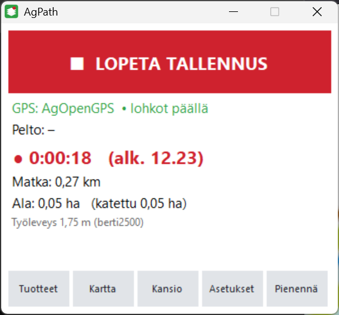
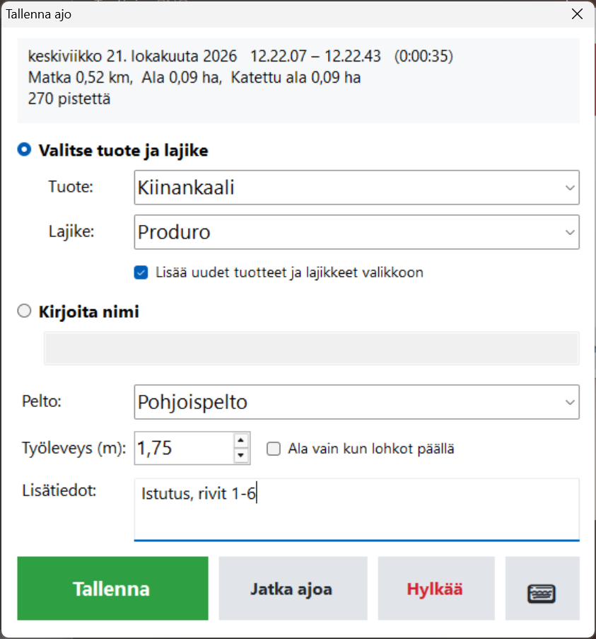
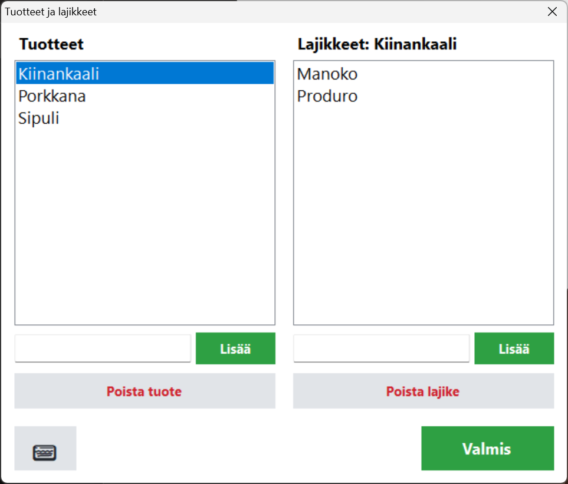
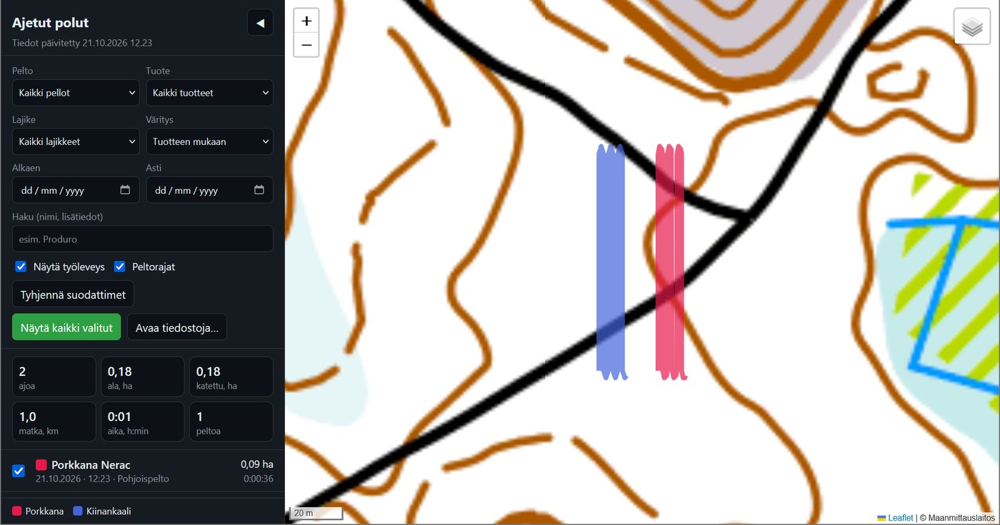
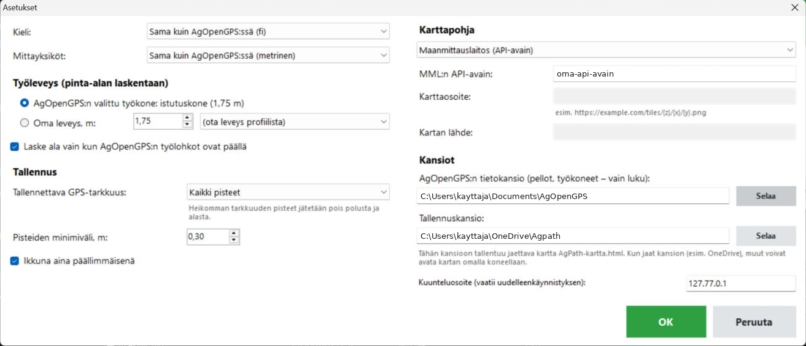

# AgPath – käyttöohje

*[In English: GUIDE.md](GUIDE.md)*

AgPath toimii AgOpenGPS:n rinnalla ja tallentaa ajetut polut. Yhdelle pellolle voi tallentaa niin monta
ajoa kuin haluaa. Jokaiseen ajoon tallentuvat tuote ja lajike, ajat ja pinta-ala. Itse AgOpenGPS:ään ei
tehdä mitään muutoksia.

- [1. Asennus](#1-asennus)
- [2. Ajon tallennus](#2-ajon-tallennus)
- [3. Ajon tallentaminen tiedostoon](#3-ajon-tallentaminen-tiedostoon)
- [4. Tuotteet ja lajikkeet](#4-tuotteet-ja-lajikkeet)
- [5. Kartta](#5-kartta)
- [5b. Kartan jakaminen](#5b-kartan-jakaminen)
- [5c. Kirjaus Agrineuvokseen](#5c-kirjaus-agrineuvokseen)
- [6. Asetukset](#6-asetukset)
- [7. Missä tiedot ovat](#7-missä-tiedot-ovat)
- [8. Ongelmatilanteet](#8-ongelmatilanteet)

## 1. Asennus

1. Lataa **AgPath.zip** [uusimmasta julkaisusta](https://github.com/Maco1981/Agpath/releases/latest).
2. Pura se haluamaasi kansioon, esim. `Tiedostot\AgPath`. Älä käynnistä ohjelmaa suoraan zip-tiedoston sisältä.
3. Käynnistä AgOpenGPS normaalisti ja sen jälkeen **AgPath.exe**.
   * Ensimmäisellä kerralla Windows voi näyttää ilmoituksen "Windows suojasi tietokonettasi", koska
     ohjelmaa ei ole allekirjoitettu. Valitse **Lisätietoja → Suorita silti**.
   * Vinkki: napsauta `AgPath.exe`-tiedostoa hiiren oikealla → *Lähetä* → *Työpöytä (luo pikakuvake)*.

Asennusohjelmaa tai järjestelmänvalvojan oikeuksia ei tarvita. Poistaminen: poista kansio.

## 2. Ajon tallennus



* Paina **ALOITA TALLENNUS**. Nappi muuttuu punaiseksi: **LOPETA TALLENNUS**.
* Ikkunassa näkyvät:
  * **GPS**: mistä sijainti tulee (AgOpenGPS tai AgIO) ja ovatko AgOpenGPS:n lohkot päällä,
  * **Pelto**: AgOpenGPS:n pelto, jolla olet. Se tunnistetaan peltorajoista.
  * kulunut aika, matka ja ala,
  * käytetty työleveys, joka tulee AgOpenGPS:ssä valitusta työkoneesta.
* Ikkuna pysyy aina AgOpenGPS:n päällä. Vedä se kohtaan, jossa se ei ole tiellä.
  **Pienennä** tekee siitä kapean palkin. Palkkia napauttamalla saat koko ikkunan takaisin.
* Käynnissä oleva ajo varmuuskopioidaan 15 sekunnin välein. Jos kone sammuu kesken ajon, AgPath tarjoaa
  seuraavalla käynnistyksellä ajon jatkamista tai tallentamista.

## 3. Ajon tallentaminen tiedostoon

Paina **LOPETA TALLENNUS**. Tallennusikkuna avautuu:



* Ylhäällä näkyvät päivämäärä, aloitus- ja lopetusaika, kesto, matka ja ala.
* **Valitse tuote ja lajike**: napauta kenttää, niin valikko aukeaa, tai kirjoita uusi nimi. Kun valitset
  tuotteen, lajikevalikko aukeaa automaattisesti. Uudet nimet lisätään valikkoon, kun
  *Lisää uudet tuotteet ja lajikkeet valikkoon* on valittuna.
* **Kirjoita nimi**: tuotteen sijaan oma nimi, esim. "Lannoitus, pohjoispää".
* **Pelto** täyttyy automaattisesti. Sitä voi muuttaa.
* **Työleveys (m)**: korjaa tarvittaessa. Ala lasketaan heti uudelleen.
* **Ala vain kun lohkot päällä**: jättää pois kohdat, joissa AgOpenGPS:n lohkot olivat pois päältä, esim. päisteiden käännökset.
* **Lisätiedot**: vapaa teksti.
* **Tallenna** tallentaa ajon, **Jatka ajoa** palaa tallennukseen ja **Hylkää** heittää ajon pois.
  **⌨**-nappi avaa näyttönäppäimistön.

Ala näytetään kahtena lukuna:

* **Ala**: ajettu matka × työleveys.
* **Katettu ala**: todellisuudessa peitetty alue. Päällekkäin ajettu lasketaan vain kerran.

## 4. Tuotteet ja lajikkeet

Pääikkunan **Tuotteet**-napista aukeavat valikot. Ne voi täyttää jo ennen kautta.



Valitse vasemmalta tuote, niin sen lajikkeet näkyvät oikealla ja niitä voi muokata. Tuotteen tai lajikkeen
poistaminen valikosta ei muuta jo tallennettuja ajoja.

## 5. Kartta

**Kartta**-nappi avaa kaikki tallennetut ajot selaimeen.



* Suodata **pellon, tuotteen, lajikkeen, päivämäärän** tai hakusanan mukaan. Laatikoissa näkyvät valittujen
  ajojen yhteismäärät: ajot, ala, katettu ala, matka, aika ja peltojen määrä.
* **Väritys**: tuotteen, lajikkeen tai pellon mukaan, tai jokainen ajo eri värillä.
* **Näytä työleveys** piirtää polun työkoneen levyisenä.
* Napsauta ajoa listasta tai kartalta, niin kartta kohdistuu siihen ja näyttää sen tiedot.
* Oikean yläkulman tasonappi vaihtaa karttapohjan sekä näyttää peltorajat ja peltojen nimet.
* **Avaa tiedostoja…** näyttää muualta tuodut GeoJSON-tiedostot, esim. toiselta koneelta.

Karttapohja tarvitsee nettiyhteyden. Polut ja peltorajat näkyvät ilman sitäkin.

## 5b. Kartan jakaminen

AgPath pitää tallennuskansiossa yhtä itsenäistä karttatiedostoa: **`AgPath-kartta.html`**. Siinä ovat kartta,
kaikki ajot ja peltorajat, ja se päivittyy aina, kun ajo tallennetaan. Kuka tahansa voi avata sen selaimessa
omalla koneellaan ilman AgOpenGPS:ää tai AgPathia.

**Jakaminen esimerkiksi pomolle tai työkavereille OneDriven kautta:**

1. Valitse AgPathin **Asetukset → Tallennuskansio** -kohtaan kansio OneDriven sisältä, esim. `OneDrive\AgPath`,
   ja paina OK. Aiemmin tallennetut ajot jäävät vanhaan kansioon. Kopioi ne uuteen kansioon, jos haluat
   ne mukaan jaettuun karttaan.
2. Napsauta kansiota Resurssienhallinnassa hiiren oikealla → **Jaa** (OneDrive) ja kutsu pomosi.
3. Pomosi avaa jaetusta kansiosta **AgPath-kartta.html**-tiedoston: omalla koneellaan OneDrive-sovelluksen
   kautta tai lataamalla tiedoston OneDriven verkkosivulta.

Uudet ajot näkyvät jaetulla kartalla aina, kun traktorin koneella on nettiyhteys ja OneDrive on ehtinyt
synkronoida. Pomon tarvitsee vain päivittää sivu.

Huom: jos käytät Maanmittauslaitoksen karttapohjaa, API-avaimesi on mukana jaetussa tiedostossa. Oman
yrityksen sisällä se on yleensä ok, mutta älä julkaise tiedostoa. Jos et halua jakaa avainta, valitse
karttapohjaksi **OpenStreetMap**.

## 5c. Kirjaus Agrineuvokseen

Jos koneella on Suonentiedon **Agrineuvos**, AgPathin pääikkunaan tulee painike **Agrineuvos**. Sillä tallennetut
ajot voi kirjata Agrineuvokseen toteutettuina tapahtumina (lohkon Toteutettu-välilehti): tarvike, päivämäärä,
pinta-ala, halutessa määrä/ha sekä Info-kenttään ajon tiedot (aika, matka, työleveys, muistiinpanot).

Agrineuvoksessa ei ole tiedostotuontia toimenpiteille, joten AgPath käyttää Agrineuvosta samoin kuin ihminen:
se avaa lohkon, valitsee *Lisää tapahtuma*, hakee tarvikkeen ja täyttää tiedot. Jokaisessa vaiheessa AgPath
tarkistaa, että Agrineuvos näyttää oikeaa lohkoa ja tarviketta, ennen kuin se painaa OK. Jos jokin ei täsmää,
AgPath peruu kyseisen kirjauksen eikä tallenna mitään.

1. Avaa Agrineuvos ja tilasi. Sulje Agrineuvoksesta muut ikkunat.
2. Paina AgPathissa **Agrineuvos**. Listassa ovat ajot, joita ei ole vielä kirjattu.
3. Napauta ajoa ja täytä kerran:
   * **Agrineuvoksen lohkotunnus**, esim. `1-A` (muistetaan tälle AgOpenGPS-lohkolle),
   * **Tarvike** täsmälleen kuten Agrineuvoksessa, esim. `Kaura Luukas 2025` (muistetaan tälle tuotteelle ja lajikkeelle),
   * halutessasi **Määrä/ha** (esim. kylvömäärä tarvikkeen yksikössä),
   * halutessasi **Pinta-ala** tälle ajolle, jos haluat kirjata eri alan kuin AgPath mittasi (tyhjä = mitattu ala).
4. Valitse, kirjataanko pinta-alaksi **katettu ala** vai **ajettu ala**.
5. Rastita kirjattavat ajot ja paina **Kirjaa valitut Agrineuvokseen**. Älä käytä hiirtä tai näppäimistöä ennen
   kuin AgPath ilmoittaa valmistuneensa (noin 20 s / ajo).
6. Tarkista tulos Agrineuvoksessa. Kirjatut ajot merkitään AgPathissa kirjatuiksi, eikä niitä kirjata uudelleen.

Huomioita:

* Kirjaus tehdään ajon päivämäärän kasvukaudelle. Jos kasvukautta ei ole vielä perustettu Agrineuvoksessa,
  AgPath pysähtyy eikä perusta sitä.
* Agrineuvoksen päivitys voi muuttaa sen ikkunoita. Jos kirjaus alkaa epäonnistua päivityksen jälkeen, tee
  [ilmoitus](https://github.com/Maco1981/Agpath/issues). Tapahtumat voi aina kirjata myös käsin.
* Toiminto ei liity Suonentietoon eikä ole heidän tukemansa.

## 6. Asetukset



* **Kieli**: oletuksena sama kuin AgOpenGPS:ssä. Uusi kieli tulee käyttöön, kun AgPath käynnistetään uudelleen.
* **Mittayksiköt**: oletuksena samat kuin AgOpenGPS:ssä (metrinen: km, ha, km/h, m tai brittiläinen: mi, ac, mph, ft).
  Voit valita ne myös itse. Tallennetut tiedostot ovat aina metrisinä.
* **Työleveys**: AgOpenGPS:n valittu työkone tai oma leveys. Leveyden voi ottaa myös mistä tahansa
  AgOpenGPS:n työkoneprofiilista.
* **Laske ala vain kun AgOpenGPS:n työlohkot ovat päällä**: tallennusikkunan oletusvalinta.
* **Tallennettava GPS-tarkkuus**: *Kaikki pisteet*, *RTK fix ja RTK float* tai *Vain RTK fix*. Heikomman
  tarkkuuden pisteet jätetään pois polusta ja alasta, eikä polkua yhdistetä katkon yli. Kun pisteitä jätetään
  pois, pääikkunan GPS-rivillä lukee punaisella **EI TALLENNETA**. Hyödyllinen kaukana RTK-tukiasemasta.
* **Karttapohja**:
  * **OpenStreetMap** toimii kaikkialla ilman avainta.
  * **Maanmittauslaitos** antaa maastokartan, ilmakuvan ja kiinteistörajat. Tilaa oma ilmainen API-avain
    [Maanmittauslaitokselta](https://www.maanmittauslaitos.fi/rajapinnat/api-avaimen-ohje) ja liitä se tähän.
  * **Oma karttaosoite** toimii minkä tahansa XYZ-karttapalvelun kanssa: `https://…/{z}/{x}/{y}.png`.
    Täytä *Kartan lähde* palvelun vaatimalla tavalla.
* **AgOpenGPS:n tietokansio** löytyy automaattisesti. AgPath vain lukee sieltä pellot ja työkoneet.
* **Tallennuskansio**: minne ajot tallennetaan.
* **Kuunteluosoite**: muuta vain, jos AgPath ilmoittaa, ettei se saa porttia auki.

## 7. Missä tiedot ovat

```
AgPath\Recordings\<pelto>\2026-10-21_1223_Kiinankaali_Produro.geojson
AgPath\Recordings\<pelto>\2026-10-21_1223_Kiinankaali_Produro.kml
AgPath\Recordings\recordings.csv
```

* **.geojson** aukeaa QGIS:ssä ja verkkokartoissa, esim. geojson.io. Sitä voi käyttää myös omissa ohjelmissa.
  Kenttien kuvaus on [README:ssä](../README.md#files).
* **.kml** aukeaa Google Earthissa ja Google My Mapsissa.
* **recordings.csv** on kaikkien ajojen yhteenveto, joka aukeaa Excelissä.
* AgPath-kansion `products.txt` ja `settings.txt` sisältävät valikot ja asetukset. Kopioi ne
  `Recordings`-kansion mukana, kun siirrät AgPathin toiselle koneelle.

## 8. Ongelmatilanteet

| Ongelma | Mitä tehdä |
|---|---|
| **GPS: ei sijaintia** | Käynnistä AgOpenGPS (tai vähintään AgIO) ja varmista, että se saa GPS-sijainnin. AgPath kuuntelee vain samaa konetta. |
| "Portin … avaus epäonnistui" | Jokin muu ohjelma käyttää samaa osoitetta. Vaihda Asetuksista *Kuunteluosoite*, esim. `127.77.0.2`, ja käynnistä AgPath uudelleen. |
| **Pelto: –** | Olet kaikkien AgOpenGPS:n peltorajojen ulkopuolella, tai pellolla ei ole rajaa. Pellon nimen voi kirjoittaa tallennettaessa. |
| Ala on 0 | *Ala vain kun lohkot päällä* on valittuna, mutta lohkot olivat pois. Poista valinta tallennusikkunassa. |
| recordings.csv ei päivity | Tiedosto on auki Excelissä. Sulje se. Itse ajo tallentui silti. |
| Kartta on harmaa | Nettiyhteys puuttuu, tai MML:n API-avain on väärä tai puuttuu. |
| "AgPath on jo käynnissä" | Ohjelma on jo auki, ehkä pienennettynä. Katso tehtäväpalkista. |

**Testaus ilman traktoria**: käynnistä AgPath, paina ALOITA TALLENNUS ja aja `tools\TestSender.exe`. Se lähettää
simuloidun ajon (6 kaistaa × 80 m) samalla tavalla kuin AgOpenGPS.

Kysymykset ja kehitysideat: [Issues](https://github.com/Maco1981/Agpath/issues).
